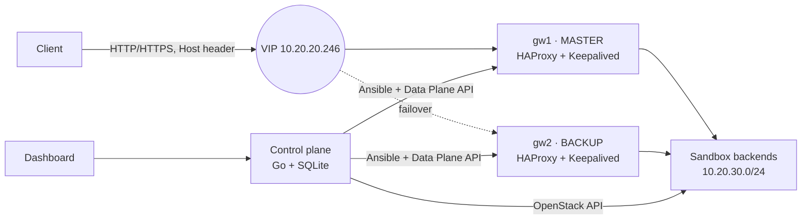

<div align="center">

# FelCloud — Phase 3 Submission

### Resilient IP Gateway and Multi-Tenant Routing for OpenStack

**High-availability edge gateways · Host-based routing · IP address management · Automated sandbox lifecycle · Operator dashboard**


[Highlights](#highlights) · [Architecture](#architecture-at-a-glance) · [Quick start](#quick-start) · [Docs](#documentation) · [License](#license)

</div>

## Highlights

- **Infrastructure as Code & Gateway Automation**: Fully declarative OpenStack topology in Pulumi Go ([`infra/`](infra/)) and idempotent Ansible roles ([`ansible/`](ansible/)) provisioning dual HAProxy/Keepalived gateways and isolated tenant networks.
- **Active-Passive VRRP Failover**: Dual edge gateways sharing a virtual IP (`10.20.20.246`) with sub-1.3s failover demonstrated across Bastion and WAN paths under node failure.
- **Transactional L7 Routing & Zero Downtime**: HAProxy host-based reverse proxying validated via the Data Plane API before atomic commits ([`controlplane/gateway_sync.go`](controlplane/gateway_sync.go)), delivering 0 dropped requests during reloads.
- **Concurrency-Safe IPAM with Quarantine**: SQLite WAL immediate transactions prevent address collisions across burst allocations, with 300s quarantine cooldown and background reaper retry ([`controlplane/reaper.go`](controlplane/reaper.go)).
- **Single-Command Containerized Operations**: Multi-stage Docker Compose stack ([`docker-compose.yml`](docker-compose.yml)) running the Go control plane and React 19 operator console in mock mode out of the box, with live OpenStack and benchmark profiles.

## Architecture at a glance



| Layer | Implementation | Responsibility |
|---|---|---|
| Infrastructure | Pulumi Go, [infra/](infra/) | Networks, router, VIP port, security groups, gateways, bastion |
| Gateway runtime | Ansible, [ansible/](ansible/) | HAProxy, Keepalived, TLS, and HAProxy Data Plane API |
| Control plane | Go service, [controlplane/](controlplane/) | REST API, SQLite IPAM, sandbox lifecycle, gateway sync, reconciliation |
| Dashboard | React 19 + Vite, [dashboard/](dashboard/) | Operator console served by the control plane at `/ui/` |
| Validation | Python harness, [bench/](bench/) | Benchmark scenarios (T1–T7) with raw metrics, summaries, and charts |

## Quick start

Docker Compose v2 runs the control plane and dashboard in mock mode without cloud credentials:

```bash
git clone <repository-url> && cd <repository-directory>
export ADMIN_TOKEN="$(openssl rand -hex 32)"     # at least 24 characters
docker compose up -d --build
```

Verify the service is healthy and access the operator console:
```bash
curl -sf http://localhost:8081/health
# Open http://localhost:8081/ui/ in your browser and sign in with $ADMIN_TOKEN
```

To load realistic demo data, run `docker compose --profile seed run --rm seed`.
For live OpenStack deployment, native builds, and full environment variables, see [Deployment](docs/deployment.md).


## Known limitations and design scope

| Area | Observation | Mitigation / status |
|---|---|---|
| **Gateway sync under provisioning bursts** | During bursts of sequential provisioning (T1, [`t1_provisioning_20261018T133258Z`](bench/results/raw/t1_provisioning_20261018T133258Z_summary.json)), a route synchronisation can exceed its deadline in the `gateway_sync` step and the provisioning request is reported as failed. | Planned: batch route updates and queue gateway reloads with a debounce, so that several routes share one commit. |
| **Failover time depends on the failure mode** | When Keepalived stops on the master, traffic moves to gw2 in about 1.1 to 1.2 s (T3, [`t3_failover_20261019T174949Z`](bench/results/raw/t3_failover_20261019T174949Z_summary.json), bastion and WAN probes). When only HAProxy stops, detection is bound by the health-check schedule and the first gw2 response arrives after about 5.6 to 6.5 s in the same run. | The check schedule is configurable (`keepalived_check_interval`, `keepalived_check_fall`); the measured values and the detection-time formula are in [High availability](docs/high-availability.md). |
| **External WAN convergence** | The WAN path crosses upstream switches that must relearn the floating IP after a transition. This step is outside the gateways' control and varied between runs: 22.4 s in [`…145556Z`](bench/results/raw/t3_failover_20261019T145556Z_summary.json) against 1.13 s in `…174949Z` for the same scenario. The upstream relearning is the likely cause; it is not measured directly. | Needs provider-side support (for example gratuitous ARP handling or a routed VIP). Outside the scope of this deployment. |

**Scope decision: single control-plane instance.** The control plane runs as one instance with an embedded SQLite database (WAL mode), a choice made with the project mentor to keep the system simple and operable. It is not part of the client data path: if it is unavailable, the gateways keep routing the configured routes, and only provisioning and lifecycle operations pause until it restarts. The rationale and the conditions under which this choice should be revisited are in [Architecture](docs/architecture.md).
## Repository guide

| Path | Contents |
|---|---|
| [controlplane/](controlplane/) | Go API, IPAM, provisioning, reconciliation, gateway operations |
| [dashboard/](dashboard/) | Operator web interface (React 19 + Vite) |
| [infra/](infra/) | Pulumi OpenStack resources and Heat template |
| [ansible/](ansible/) | Gateway inventory, roles, and playbooks |
| [bench/](bench/) | Benchmark harness, report generator, and committed results |
| [scripts/](scripts/) | Operational helper and verification scripts |
| [docs/](docs/) | Technical reference documentation |
| [Dockerfile](Dockerfile), [docker-compose.yml](docker-compose.yml) | Multi-stage container build and compose specification |
| [.env.example](.env.example) | Configuration template for environment variables |

## License

This project is licensed under the [MIT License](LICENSE). FelCloud trademarks, logos, and brand assets are not covered by the MIT License and remain the property of Cloud Pulse.
