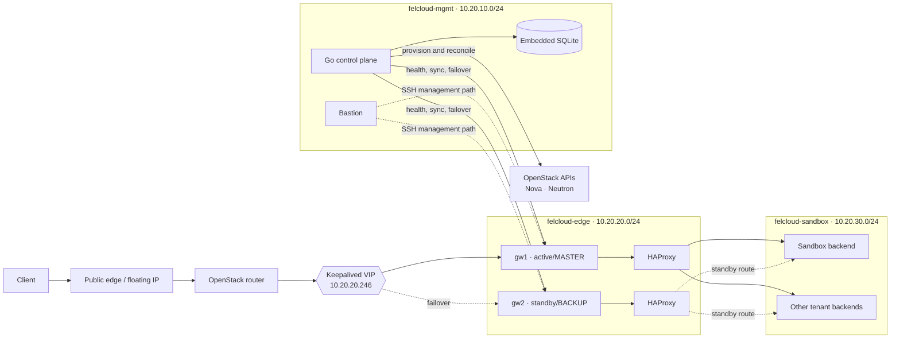

# Architecture

This document describes the actual architecture implemented in the current codebase. It is written from source and configuration evidence and is intentionally narrower than historical design prose.

## High-level topology

The repository models a three-network OpenStack design:

- `felcloud-edge` (`10.20.20.0/24`) — public entry, VIP, VRRP heartbeat, HAProxy/Keepalived on gateway nodes
- `felcloud-sandbox` (`10.20.30.0/24`) — isolated tenant endpoints and sandbox VMs
- `felcloud-mgmt` (`10.20.10.0/24`) — control-plane host, bastion access, gateway management, DPA access

The runtime data path is:

Client → public edge / floating IP / VIP → active gateway → HAProxy → correct sandbox backend

This is consistent with the request flow shown in [../README.md](../README.md) and the gateway API reference in [api-gateways.md](api-gateways.md).

The diagram separates the client data path from the management/control path. The control plane orchestrates and records state; client traffic is handled by the active gateway pair and does not pass through the control-plane process.

## Control plane

The active control plane is implemented in Go.

Relevant files:

- [../controlplane/main.go](../controlplane/main.go) — CLI entrypoint and server startup
- [../controlplane/server.go](../controlplane/server.go) — HTTP API router and gateway API surface
- [../controlplane/auth.go](../controlplane/auth.go) — bearer auth, CORS, rate limiting, token validation
- [../controlplane/ipam.go](../controlplane/ipam.go) — SQLite-backed IP allocation and lifecycle logic
- [../controlplane/provisioning.go](../controlplane/provisioning.go) — sandbox provisioning and state handling
- [../controlplane/reconcile.go](../controlplane/reconcile.go) — reconciliation and stale resource handling
- [../controlplane/gateway_sync.go](../controlplane/gateway_sync.go) — generated HAProxy configs and sync behavior
- [../controlplane/gateway_failover.go](../controlplane/gateway_failover.go) — failover logic and gateway health transitions
- [../controlplane/gateway_deploy.go](../controlplane/gateway_deploy.go) — deploy, rollback, and generation tracking

### Responsibilities

The control plane is responsible for:

- IP allocation and lease lifecycle
- sandbox provisioning and teardown coordination
- gateway state checks and health evaluation
- HAProxy config generation and transaction validation
- failover and rollback orchestration
- control-plane dashboard and API exposure
- event recording and observability

It is not a user-facing data-plane component. The data plane is the active gateway pair running HAProxy and Keepalived.

## Data plane

The data plane consists of the two gateway nodes that participate in VRRP and serve traffic.

Relevant files:

- [../ansible/roles/haproxy](../ansible/roles/haproxy) — HAProxy deployment and config generation
- [../ansible/roles/keepalived](../ansible/roles/keepalived) — Keepalived and check scripts
- [../ansible/site.yml](../ansible/site.yml) — gateway role wiring
- [../infra/gateways.go](../infra/gateways.go) — VM definitions for the gateway nodes
- [../infra/gateway_ports.go](../infra/gateway_ports.go) — management, edge, and VIP port wiring
- [../infra/vip.go](../infra/vip.go) — VIP port and address placement

### Data-plane behavior

- HAProxy terminates TLS and evaluates Host ACLs
- Keepalived manages the VIP ownership and failover
- The gateway pair exposes management and data-plane services over the `felcloud-mgmt` and `felcloud-edge` networks
- The control plane communicates with the gateways over SSH and the HAProxy Data Plane API

## Infrastructure and deployment model

The infrastructure layer is implemented with Pulumi under [../infra](../infra).

Major runtime objects are created there, including:

- network creation
- router and external routing
- floating IP/public edge routing
- security groups and allowed-address logic
- bastion instance provisioning
- gateway VM provisioning
- VIP port reservation
- sandbox network definitions

Core files:

- [../infra/main.go](../infra/main.go)
- [../infra/network.go](../infra/network.go)
- [../infra/router.go](../infra/router.go)
- [../infra/vip.go](../infra/vip.go)
- [../infra/gateways.go](../infra/gateways.go)
- [../infra/bastion.go](../infra/bastion.go)
- [../infra/security.go](../infra/security.go)

## Authentication and runtime boundaries

The control-plane API enforces bearer auth unless `AUTH_DISABLED=true` is explicitly set. The relevant logic is in [../controlplane/auth.go](../controlplane/auth.go).

Runtime security boundaries include:

- admin bearer token authorization for mutating requests
- optional CORS origin enforcement
- request rate limiting by client IP
- gateway event token support for gateway-originated events
- explicit accept-new or deny conditions around SSH trust, depending on config and deployment setup

## Lifecycle and state flow

The active state is tracked across:

- IPAM database in the control plane
- generated gateway configuration generations
- sandbox lifecycle rows and lease state
- event stream entries for gateway actions

This is documented further in [reference.md](reference.md) and [security.md](security.md).

## Important caveats

- The architecture described in older docs is partially historical; the current repo is the Go implementation.
- Some local runtime files (database state, compiled binaries) are operational artifacts and should not be treated as canonical source files.
- Live failover, rollback, and real OpenStack provisioning still require live infrastructure and should be treated as not verified unless explicitly tested in an environment.
