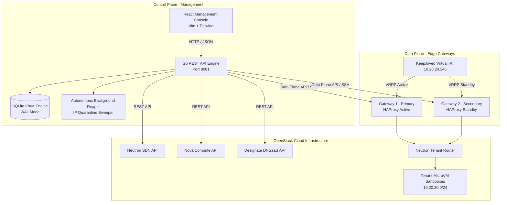

# System Architecture

FelCloud is an edge gateway resilience and IP optimization platform designed to manage high-density tenant microVM sandboxes in OpenStack cloud environments. It provides isolated tenant routing, high-availability failover, and automated address reclamation.

## 1. High-Level Architecture

The architecture separates the **Control Plane** (orchestration, IPAM, state tracking) from the **Data Plane** (traffic routing, proxying, packet forwarding).



## 2. Component Boundaries & Responsibilities

### 2.1 Edge Gateways (`gw1` and `gw2`)
The edge gateways run Ubuntu Linux 24.04 and provide ingress traffic routing for all tenant sandboxes:
- **HAProxy 2.8:** Handles HTTP/HTTPS reverse proxying, TLS termination (TLS 1.3), sticky-table rate limiting (HTTP 429), and host-header routing (`<team>.<domain>`).
- **HAProxy Data Plane API:** REST API daemon running on port 5555, allowing transactional configuration reloading and rollback without service disruption.
- **Keepalived VRRP:** Maintains a shared Virtual IP (`10.20.20.246`) between `gw1` (priority 150) and `gw2` (priority 100). If the primary gateway's HAProxy health check fails, VRRP priority drops by 60 points, instantly shifting the VIP to `gw2`.

### 2.2 Go Control Plane (`controlplane/`)
A standalone Go service that orchestrates infrastructure state and gateway configuration:
- **IPAM Engine:** Manages a deterministic pool of IP addresses backed by SQLite in WAL mode with immediate transaction locking.
- **Lease Reaper:** Background worker running every 10 seconds to detect expired sandboxes, trigger teardown routines, place IPs into quarantine, and return them to the free pool after cooldown.
- **Gateway Synchronizer:** Renders HAProxy routing rules dynamically and synchronizes them across both gateways using the HAProxy Data Plane API or Ansible fallbacks.
- **Audit Logger:** Persists immutable event records in SQLite for all provisioning, deprovisioning, failover, and rollback actions.

### 2.3 Web Dashboard (`dashboard/`)
A modern single-page application built with React 19, TypeScript, and Vite:
- Real-time telemetry monitoring for both gateways (HAProxy state, VRRP status, request counts, response latency).
- Interactive sandbox provisioning and lease lifetime extension.
- IPAM pool inspection across all states (FREE, ALLOCATED, QUARANTINED).
- Manual emergency controls for cluster failover and atomic configuration rollback.

### 2.4 Infrastructure as Code (`infra/` & `ansible/`)
- **Pulumi Go SDK (`infra/`):** Declaratively provisions OpenStack networks, subnets, routers, security groups, keypairs, and the management bastion.
- **Ansible Playbooks (`ansible/`):** Automatically configures gateways, installs HAProxy and Keepalived, generates systemd unit files, and deploys TLS certificates.

## 3. Control Plane vs Data Plane Separation

To prevent cascading failures, the control plane and data plane are strictly decoupled:
- **Data Plane Survivability:** If the Go control plane crashes or is restarted, existing tenant routes and in-flight traffic through HAProxy and Keepalived continue uninterrupted.
- **Non-Blocking API Calls:** Provisioning requests use asynchronous patterns (`202 Accepted`) where initial lease reservation is immediate, followed by asynchronous VM booting and gateway route injection.
- **Isolated Networks:** Tenant sandboxes reside in a private subnet (`10.20.30.0/24`) and can only receive traffic forwarded by the gateways; they have no direct access to the management subnet (`10.20.10.0/24`).

### 3.1 Provisioning Pipeline & Measured Timing Characteristics

The end-to-end sandbox provisioning lifecycle involves multiple asynchronous cloud stages:

```
[ POST /api/sandboxes ]
       │
       ├─► 1. IPAM Allocation: Atomic SQLite reservation (< 200 ms)
       ├─► 2. Neutron Port Creation: OpenStack SDN port creation (~600 ms)
       ├─► 3. Nova VM Scheduling: OpenStack microVM instance build (~20 s)
       ├─► 4. Cloud-Init Boot: MicroVM guest OS boot & HTTP healthz readiness (~145 s)
       └─► 5. Gateway Route Sync: Dual HAProxy DPA transaction & reload (~51 s)
              │
              ▼
   [ First HTTP 200 via VIP: ~217 s median ]
```

**Empirical Timing & Known Limits (T1 Benchmark):**
- In full evaluation run [`t1_provisioning_20261018T133258Z`](../bench/results/raw/t1_provisioning_20261018T133258Z_summary.json) ($n=30$):
  - **Success Rate:** 90.0% (27/30 succeeded, 3 failed).
  - **Total Latency to First 200:** Median (`p50`) **217.1 s**, `p95` **234.4 s** (dominated by cloud-init package installation and guest boot).
  - **Known Limit:** Under rapid sequential provisions, 3 runs encountered `gw1 HAProxy is not active\nroute cleanup sync: context deadline exceeded` during Data Plane API reload verification. The system handles this gracefully by rolling back the allocation and returning an actionable HTTP 502 status.

## 4. Threat Model Summary

- **Cross-Tenant Impersonation:** Prevented by gateway-level SNI and Host header ACL mapping. Tenants cannot spoof other tenants' internal IP addresses or host headers.
- **Denial of Service (DoS):** Mitigated by HAProxy stick-table rate limiting (100 req/s per IP), returning HTTP 429 when thresholds are exceeded.
- **Data Leakage via Recycled IPs:** Mitigated by mandatory quarantine cooldown periods (`IP_QUARANTINE_SECONDS=300`) ensuring stale ARP tables, sockets, and routes clear before an address is reassigned.
- **Unauthorized Management Access:** Control plane mutating APIs require a bearer token (`ADMIN_TOKEN`). Gateway SSH access requires jump-host proxying via the Bastion.

## 5. License & Dependency Compatibility

FelCloud is licensed under the [MIT License](../LICENSE). See [LICENSE](../LICENSE) for full details. FelCloud trademarks, logos, and brand assets are not covered by the MIT License and remain the property of Cloud Pulse.

All external runtime and build dependencies are distributed under compatible permissive licenses:
- **Go Control Plane:** `github.com/gophercloud/gophercloud` (Apache-2.0), `github.com/mattn/go-sqlite3` (MIT), `gopkg.in/yaml.v3` (MIT/Apache-2.0).
- **Dashboard Frontend:** React 19 (MIT), React Router 7 (MIT), TanStack Query (MIT), Lucide React (ISC), Zod (MIT), Tailwind CSS (MIT), Vite (MIT).
- **Benchmark Suite:** `httpx` (BSD-3-Clause), `matplotlib` (PSF), `pyyaml` (MIT), `requests` (Apache-2.0), `pytest` (MIT).

Zero copyleft (GPL, AGPL) components are packaged in the runtime or container images.
