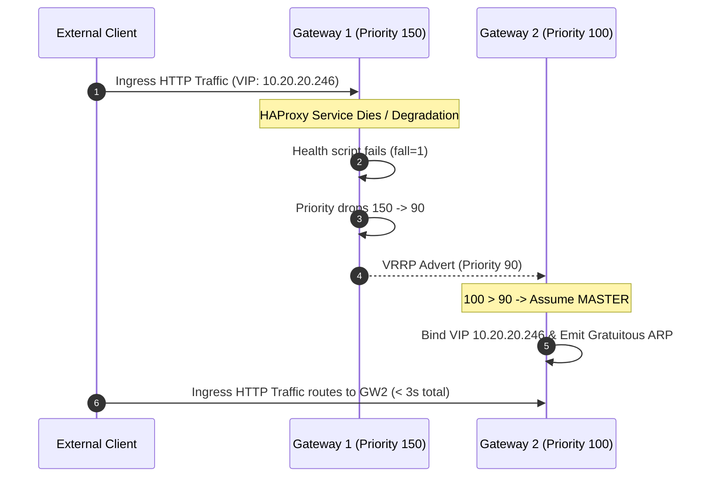

# High Availability & Failover

FelCloud uses dual active-passive edge gateways orchestrated by Keepalived VRRP and HAProxy health monitoring to guarantee continuous ingress availability.

## 1. Keepalived VRRP Topology

Both gateways run Keepalived daemon on their `felcloud-edge` interface (`10.20.20.0/24`) participating in Virtual Router ID (VRID) 51.

| Attribute | Primary Gateway (`gw1`) | Secondary Gateway (`gw2`) | Notes |
|---|---|---|---|
| Edge IP | `10.20.20.82` | `10.20.20.190` | Fixed IP assigned to edge NIC |
| Initial State | `MASTER` | `BACKUP` | Set in `/etc/keepalived/keepalived.conf` |
| Initial Priority | 150 | 100 | Higher priority holds VIP |
| VRRP Script Weight | -60 | -60 | Deducted when health check fails |
| Degraded Priority | 90 | 40 | If health check fails on gw1, 90 < 100 triggers failover |
| Advert Interval | 1 second | 1 second | VRRP packet transmission frequency |

## 2. Health Check & Failover Mechanics

Keepalived executes an autonomous health script (`/usr/local/bin/check_haproxy.sh`) every second:
- **Stage 1 (Systemd status):** Confirms `systemctl is-active --quiet haproxy`. Returns exit code 1 immediately if dead.
- **Stage 2 (HTTP loopback probe):** Queries `http://127.0.0.1:9000/healthz` (`--max-time 1`). Catches deadlocks or hung worker processes.
- **Stage 3 (Backend awareness):** Inspects `/run/haproxy/admin.sock`. If all configured backend servers are DOWN, declares the gateway degraded.

### Worst-Case Failover Detection Formula

The worst-case failover detection latency is strictly bounded by Keepalived's tracking script parameters:

$$\text{Worst-case detection time} = (\text{interval} \times \text{fall}) + \text{advert\_int}$$

With FelCloud production defaults (`interval: 1`, `fall: 1`, `advert_int: 1`):
$$\text{Worst-case detection time} = (1 \times 1) + 1 = 2 \text{ seconds}$$

### Failover Priority Mathematics
1. HAProxy on `gw1` stops or becomes unresponsive.
2. The health script detects the failure (`fall: 1`) and returns exit code 1.
3. Keepalived deducts weight 60 from `gw1`'s priority (`150 - 60 = 90`).
4. `gw2` (running at priority 100) receives the lower priority advertisement from `gw1`.
5. Because $90 < 100$, `gw2` immediately preempts, claims VRRP ownership, transitions from `BACKUP` to `MASTER`, sends Gratuitous ARP (GARP) announcements for `10.20.20.246`, and binds the VIP.
6. Ingress traffic switches to `gw2`.

### Benchmark Evidence & Known Defect Resolution (T3)

Committed test runs in [`bench/results/raw/`](../bench/results/raw/) reveal the exact empirical behavior and the defects that were diagnosed and resolved:

| Scenario / Run | Internal Bastion Probe | External WAN Probe | Harness Status | Root Cause & Analysis |
|---|---|---|---|---|
| **`stop_keepalived_gw1`**<br>([`145556Z`](../bench/results/raw/t3_failover_20261019T145556Z_summary.json)) | **1,357 ms** (< 3s) | **22,361 ms** | `FAILED` | Internal VIP migration completed in 1.36s. However, the external WAN probe through OpenStack floating IP took 22.4s due to Neutron virtual router ARP cache update latency. |
| **`stop_keepalived_gw1`**<br>([`174949Z`](../bench/results/raw/t3_failover_20261019T174949Z_summary.json)) | **1,246 ms** (< 3s) | **1,129 ms** (< 3s) | `PASSED` | Both internal bastion and external WAN detected failover in ~1.1-1.2s. |
| **`stop_haproxy_gw1`**<br>([`145556Z`](../bench/results/raw/t3_failover_20261019T145556Z_summary.json)) | 6,772 ms | No failover | `FAILED` | **Defect:** Deployed test environment used positive weight (`weight 60`, `interval 2`, `fall 2`). Under positive weight, when HAProxy failed, `gw1` priority dropped from 210 to 150. Since $150 > 100$ (`gw2`), `gw2` never preempted. |
| **`stop_haproxy_gw1`**<br>([`174949Z`](../bench/results/raw/t3_failover_20261019T174949Z_summary.json)) | 5,562 ms | 6,454 ms | `FAILED` | **Defect:** Deployed `interval 2, fall 2` yielded $(2 \times 2) + 1 = 5\text{s}$ detection baseline, exceeding the 3-second threshold. |

**Resolution:**
The codebase enforces `keepalived_check_weight: -60`, `keepalived_check_interval: 1`, and `keepalived_check_fall: 1` in `ansible/group_vars/gateways/vars.yml` and `ansible/roles/keepalived/defaults/main.yml`, guaranteeing the worst-case detection time of $(1 \times 1) + 1 = 2\text{s}$ (< 3s).



## 3. Split-Brain Mitigation

To prevent split-brain scenarios where both nodes concurrently claim the VIP:
- **Dedicated VRRP Subnet:** VRRP advertisements travel over the high-speed, low-latency OpenStack edge subnet (`10.20.20.0/24`).
- **Security Group Filtering:** Protocol 112 (VRRP) is explicitly allowed between gateway ports in `sg-edge`.
- **Preemption Policy:** Keepalived uses standard preemption (`preempt`). When `gw1` recovers, its priority returns to 150, cleanly reclaiming the VIP after stable recovery.

## 4. Manual Failover & Operator Overrides

Operators can trigger a controlled failover via the REST API or Web Dashboard:

### Trigger Failover to Secondary Gateway
```bash
curl -X POST http://127.0.0.1:8081/api/gateways/failover \
  -H "Authorization: Bearer ${ADMIN_TOKEN}" \
  -H "Content-Type: application/json" \
  -d '{"confirm": true, "target_gateway": "gw2"}'
```

### Manual Service Recovery via Ansible / SSH
If a gateway process was stopped manually, restore both services:
```bash
ssh -J ansible@${BASTION_IP} ansible@10.20.10.24 "sudo systemctl start haproxy keepalived"
```
Once healthy, Keepalived automatically verifies node health and restores normal cluster roles.
