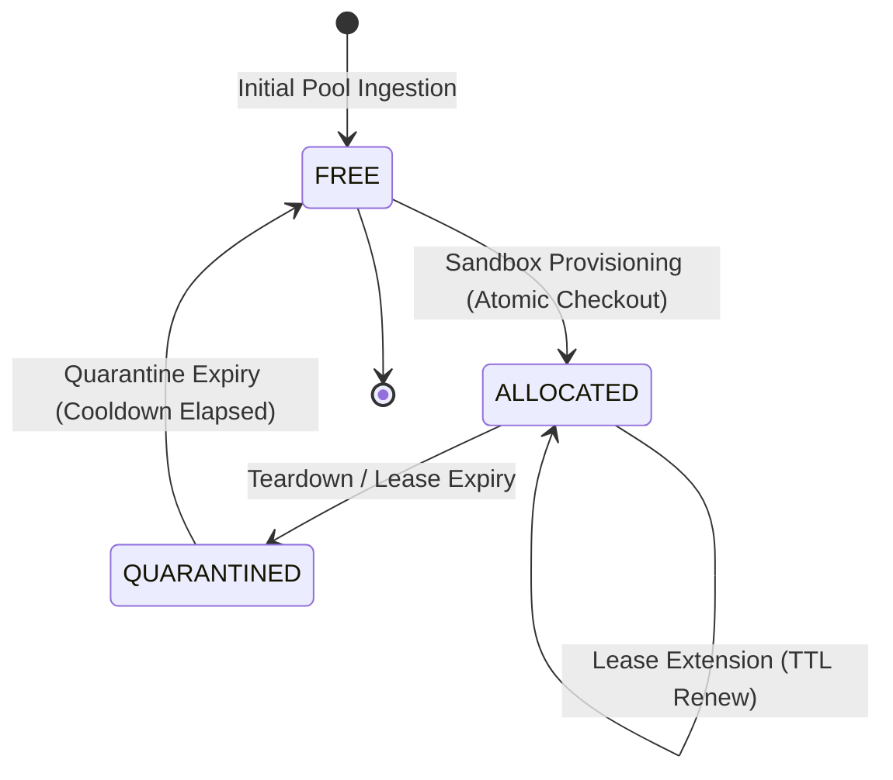

# IP Address Management (IPAM) & Lease Lifecycle

FelCloud features an integrated, lightweight IPAM engine designed to allocate, isolate, quarantine, and reclaim IP addresses for ephemeral tenant microVM sandboxes.

## 1. IP State Machine

Every IP address in the tenant sandbox pool (`10.20.30.0/24`) follows an atomic four-state lifecycle:



### State Definitions

| State | Description | Routing & Traffic Policy |
|---|---|---|
| `FREE` | Address is available in the pool. | No OpenStack port; no HAProxy route. Safe for allocation. |
| `ALLOCATED` | Assigned to an active tenant sandbox. | OpenStack Neutron port bound; HAProxy backend active; host-header route enabled. |
| `QUARANTINED` | Sandbox deleted or expired; undergoing cooldown. | OpenStack port destroyed; HAProxy route removed. Address cannot be allocated. |

## 2. Transactional Atomic Allocation

The IPAM engine uses SQLite in WAL (Write-Ahead Logging) mode with serialized immediate transaction locking (`_txlock=immediate`):

- **Immediate Reservation:** When a provisioning request arrives, the engine reserves the lowest available `FREE` address in an atomic transaction:
  ```sql
  UPDATE ip_leases
  SET status = 'ALLOCATED',
      sandbox_id = ?,
      allocated_at = ?,
      expires_at = ?,
      updated_at = ?
  WHERE id = (
      SELECT id FROM ip_leases WHERE status = 'FREE' ORDER BY id ASC LIMIT 1
  );
  ```
- **Concurrency Safety:** Because SQLite serializes immediate write transactions, race conditions and duplicate IP assignments are prevented under burst concurrency stress (verified in benchmark [`t2_concurrent_20261018T201509Z`](../bench/results/raw/t2_concurrent_20261018T201509Z_summary.json) with 100% unique allocations).

## 3. Quarantine Cooldown Period

To prevent data contamination, IP address collisions, and session crosstalk:
- When a sandbox is torn down (manually or via TTL expiration), its IP address is **not** immediately returned to `FREE`.
- Instead, the IP enters `QUARANTINED` status for a configurable duration (`IP_QUARANTINE_SECONDS`, default: 300 seconds).
- This ensures that:
  1. Neighboring hosts and routers flush stale ARP cache entries.
  2. In-flight TCP connections and lingering client sessions time out completely.
  3. Upstream DNS caches expire.

## 4. Autonomous Background Reaper & Defect Recovery

The control plane runs an autonomous background worker routine every 10 seconds:

1. **Expiry Sweep:** Queries for active leases where `expires_at <= current_time()`.
2. **Automated Teardown:**
   - Issues Nova server deletion and Neutron port removal.
   - Deletes HAProxy backend and route mappings via Data Plane API.
   - Sets IP status to `QUARANTINED` and sets `quarantine_until = current_time() + quarantine_seconds`.
3. **Quarantine Reclamation:**
   - Queries for quarantined IPs where `quarantine_until < current_time()`.
   - Transitions those records back to `FREE` status, resetting `sandbox_id` and metadata.

### 4.1 Teardown Failure Recovery & Reconciler Integration (T5 Fix)
In benchmark [`t5_lease_expiry_20261019T123746Z`](../bench/results/raw/t5_lease_expiry_20261019T123746Z_summary.json), 3 sandboxes were observed stuck in `TEARDOWN_FAILED` because the reaper query previously excluded that state.

The engine resolves this with two automated mechanisms:
- **Reaper Retry Loop:** The reaper candidate query includes `status = 'TEARDOWN_FAILED'` rows once a 30-second cooldown period has elapsed (`teardown_started_at <= now - 30`). It retries the teardown pipeline automatically.
- **Nova Server Reconciliation:** The reconciler (`reconcileNeutron`) inspects `TEARDOWN_FAILED` rows against Nova. If the microVM is already deleted in OpenStack, the reconciler reports it as a missing server and enables a clean `mark_released` transition, freeing the IP and lease.

## 5. Audit Logging

Every state transition generates an immutable audit record in SQLite (`audit_events` table), capturing:
- `event_type`: `LEASE_ALLOCATED`, `LEASE_EXTENDED`, `LEASE_QUARANTINED`, `LEASE_RECLAIMED`.
- `sandbox_id`: Associated tenant or student identifier.
- `ip_address`: Target IPv4 address.
- `timestamp`: UTC ISO 8601 event time.
- `details`: JSON payload with duration, actor, or system reason.
