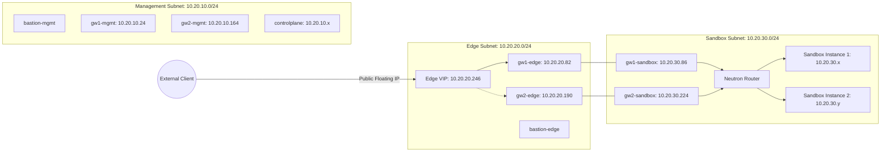

# Networking & Topology

FelCloud partitions the OpenStack cloud tenant into three isolated subnets connected through a virtual router and software-defined security groups.

## 1. Network Topology & CIDR Allocation

### Subnet Specifications

| Subnet Name | CIDR | Purpose | Gateway / Router IP | Connected Interfaces |
|---|---|---|---|---|
| `felcloud-edge` | `10.20.20.0/24` | Public ingress and edge gateway communication | `10.20.20.1` | `gw1` (`10.20.20.82`), `gw2` (`10.20.20.190`), VRRP VIP (`10.20.20.246`), Bastion edge port |
| `felcloud-mgmt` | `10.20.10.0/24` | Control plane management and SSH automation | `10.20.10.1` | `gw1` (`10.20.10.24`), `gw2` (`10.20.10.164`), Bastion mgmt port, Control Plane host |
| `felcloud-sandbox` | `10.20.30.0/24` | Tenant student microVM instances | `10.20.30.1` | `gw1` (`10.20.30.86`), `gw2` (`10.20.30.224`), Tenant MicroVM ports (`10.20.30.10` - `10.20.30.250`) |

## 2. Ingress & Egress Routing Flows

### 2.1 Ingress Flow
1. An external user sends an HTTP or HTTPS request to `team1.sandbox.example.com`.
2. Public DNS resolves `*.sandbox.example.com` to the gateway's Public Floating IP.
3. The OpenStack Neutron router directs packets to the Keepalived Virtual IP (`10.20.20.246`) on the `felcloud-edge` subnet.
4. The active gateway (`gw1`) receives the packet on its edge interface.
5. HAProxy evaluates the `Host` header (`team1.sandbox.example.com`), matches the backend server definition (`10.20.30.x:80`), and proxies the request across the `felcloud-sandbox` network.
6. The tenant sandbox processes the request and returns the response back through the gateway.

### 2.2 Management Flow
1. Operators and automated tools connect to the Bastion host via SSH (`ansible@<BASTION_IP>`).
2. SSH jump forwarding (`ProxyJump`) routes traffic from the Bastion across the `felcloud-mgmt` network (`10.20.10.0/24`) to gateway hosts `gw1` (`10.20.10.24`) or `gw2` (`10.20.10.164`).
3. Tenant sandboxes cannot initiate connections to the management network or the bastion host.

## 3. Security Groups & Traffic Rules

Security policies are enforced at the OpenStack Neutron layer using security groups:

### 3.1 Edge Security Group (`sg-edge`)
- **Ingress TCP 80:** Allowed from `0.0.0.0/0` (HTTP ingress traffic).
- **Ingress TCP 443:** Allowed from `0.0.0.0/0` (HTTPS ingress traffic).
- **Ingress VRRP (Protocol 112):** Allowed between gateway edge interfaces (`10.20.20.0/24`) for Keepalived heartbeat state exchange.
- **Egress:** Allowed to all destinations.

### 3.2 Management Security Group (`sg-mgmt`)
- **Ingress TCP 22:** Allowed from trusted administrator CIDRs to the Bastion host.
- **Ingress TCP 22 (Internal):** Allowed from the Bastion host (`10.20.10.0/24`) to gateway management ports.
- **Ingress TCP 5555:** Allowed from the Control Plane host to gateways for the HAProxy Data Plane API.
- **Egress:** Allowed to management destinations.

### 3.3 Sandbox Security Group (`sg-sandbox`)
- **Ingress TCP 80:** Allowed strictly from gateway sandbox interfaces (`10.20.30.86` and `10.20.30.224`).
- **Ingress ICMP:** Allowed from gateways for ping reachability checks.
- **Inter-Sandbox Isolation:** Traffic between individual sandbox instances on the same subnet is blocked; sandboxes cannot inspect or communicate with neighboring sandboxes.
- **Egress:** Restricted to necessary response traffic back to the gateways.

## 4. OpenStack Neutron & Designate Integration

- **Neutron Port Binding:** When a sandbox is provisioned, the control plane allocates a fixed IP from the SQLite IPAM pool, creates an OpenStack Neutron port bound to that specific IP on the `felcloud-sandbox` network, and attaches it to the Nova microVM.
- **Designate DNS Recordsets:** OpenStack Designate maintains the DNS zone (`example.com.`). A wildcard A-record (`*.sandbox.example.com.`) points directly to the edge gateway VIP. Individual sandbox names do not require distinct DNS records unless custom domain bindings are registered.
