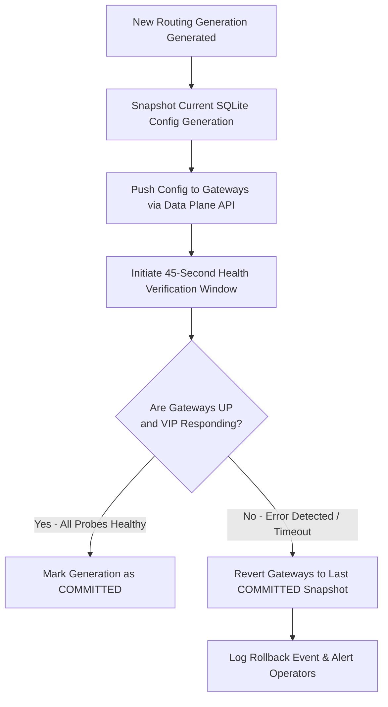

# Traffic Routing & Proxy Architecture

FelCloud relies on HAProxy 2.8 deployed on each edge gateway to handle ingress traffic distribution, tenant route isolation, TLS termination, and rate limiting.

## 1. Dynamic Host-Header Routing

Ingress requests to the gateway VIP arrive on port 80 (HTTP) or port 443 (HTTPS). HAProxy inspects the HTTP `Host` header and routes the connection to the corresponding tenant backend.

### Routing Rules Example (`haproxy.cfg`)
```haproxy
frontend http_front
    bind 10.20.20.246:80
    mode http

    # Sticky table for rate limiting (100 requests per 10s window)
    stick-table type ip size 100k expire 10s store http_req_rate(10s)
    http-request track-sc0 src
    http-request deny deny_status 429 if { sc_http_req_rate(0) gt 100 }

    # Route matching by host header
    acl is_team1 hdr(host) -i team1.sandbox.example.com
    acl is_team2 hdr(host) -i team2.sandbox.example.com
    acl is_custom_demo hdr(host) -i demo.sandbox.example.com

    use_backend team1_backend if is_team1
    use_backend team2_backend if is_team2
    use_backend team1_backend if is_custom_demo
    default_backend default_maintenance

backend team1_backend
    mode http
    server srv1 10.20.30.42:80 check inter 2s fall 3 rise 2

backend default_maintenance
    mode http
    errorfile 503 /etc/haproxy/errors/503.http
```

## 2. Transactional Deployment & Zero-Downtime Reload

Route updates occur dynamically without interrupting existing connections. The control plane implements transactional deployment via the HAProxy Data Plane API:

1. **Transaction Initialization:** The control plane begins a new transaction via `POST /v2/services/haproxy/transactions`.
2. **Atomic Modification:** Backends, servers, and frontend ACL rules are added or removed within the isolated transaction buffer.
3. **Validation & Commit:** The control plane commits the transaction via `PUT /v2/services/haproxy/transactions/{id}`. The Data Plane API validates syntax against the live HAProxy binary before applying the changes.
4. **Seamless Reload:** HAProxy performs hitless reload using socket transfer (`-x /run/haproxy/admin.sock`), ensuring zero dropped requests during process handoff.

## 3. Automated Configuration Rollback

To prevent service outages caused by bad configurations, the control plane enforces an automated rollback engine:



- **Health Window:** Configurable via `HEALTH_REGRESSION_WINDOW_SECONDS` (default: 45 seconds).
- **Automated Rollback Latency:** If health checks fail or HAProxy reports an unrecoverable error, the previous valid configuration is pushed immediately. In benchmark [`t6_reload_rollback_20261019T142508Z`](../bench/results/raw/t6_reload_rollback_20261019T142508Z_summary.json), zero request drops occurred during reloads (`zero_sync_prober_drops: true`). The raw configuration redeployment duration is measured separately from the mandatory post-rollback health soak window.

## 4. Rate Limiting (HTTP 429)

To protect tenant sandboxes from denial-of-service attempts and abusive traffic spikes:
- Gateways track request rates per client IP in a shared HAProxy in-memory stick-table.
- If an IP exceeds 100 requests per 10-second sliding window, HAProxy immediately rejects subsequent requests with HTTP `429 Too Many Requests`.
- Verified in benchmark and operator tests using [`scripts/burst-rate-limit.sh`](../scripts/burst-rate-limit.sh).

## 5. Automated TLS Termination & Custom Domains

- **Wildcard TLS 1.3:** Incoming HTTPS connections terminate at HAProxy using a wildcard certificate covering `*.sandbox.example.com`.
- **SNI Certificate Multiplexing:** HAProxy supports multiple certificates within the `/etc/haproxy/certs/` bundle directory.
- **Custom Domain Binding:** Operators or tenants can bind custom external FQDNs (e.g. `demo.example.com`) to an active sandbox via `POST /api/sandboxes/custom-domain`. The control plane maps the custom SNI/Host header to the tenant's private backend IP.
